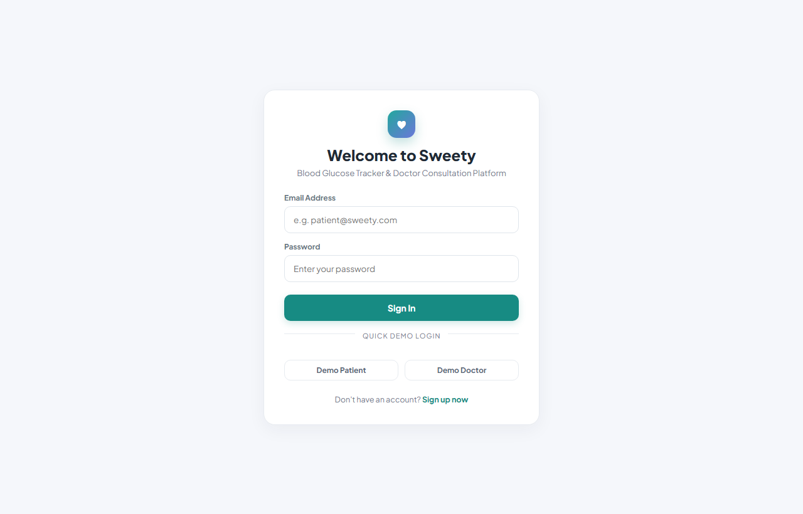

# Sweety — Blood Glucose Tracker & Doctor Consultation Platform



> **Sweety** is a comprehensive, animated healthcare web platform designed for daily diabetes management, glucose logging across four clinical time slots, and doctor consultations with continuous care and subscription verification.

**GitHub Repository:** [https://github.com/chaitanyasivathmika19/Sweety-Blood-Glucose-Tracker](https://github.com/chaitanyasivathmika19/Sweety-Blood-Glucose-Tracker)  
**Live UI/UX Prototype:** [https://chaitanyasivathmika19.github.io/Glucose-tracker-prototype/](https://chaitanyasivathmika19.github.io/Glucose-tracker-prototype/)  
**Figma Prototype:** [https://patch-drift-73153514.figma.site/](https://patch-drift-73153514.figma.site/)  

---

## Project Organization by Phases

The repository is organized into four documented phases:

| Phase | Description | Key Deliverables |
|---|---|---|
| **Phase 1** | **Requirements & System Specifications** | [`Phase-1 SWEETY Documentation.docx`](Phase-1%20SWEETY%20Documentation.docx) — Detailed clinical workflow specs, doctor-patient authorization rules, reading constraints, and notification models. |
| **Phase 2** | **Interactive UI/UX Prototype** | [`PHASE 2.docx`](PHASE%202.docx) & [Live GitHub Pages Prototype](https://chaitanyasivathmika19.github.io/Glucose-tracker-prototype/) — Interactive HTML5/CSS3/JavaScript prototype demonstrating the healthcare design system. |
| **Phase 3** | **Full-Stack Project Implementation** | [`Phase-3-Project-Implementation/`](Phase-3-Project-Implementation/) — Production React 18 + Node.js Express + PostgreSQL application with 34 automated tests (29 backend + 5 frontend). |
| **Phase 4** | **Deployment, Containerization & Hosting** | [`Phase-4-Deployment-and-Hosting/`](Phase-4-Deployment-and-Hosting/) — Render Blueprint (`render.yaml`), Docker Compose (`docker-compose.yml`), 15 genuine captured screenshots, and deployment guide. |

---

## 1. Kenpath Engineering Assignment — Mandatory Features

1. **User Sign Up and Login:**
   - Real authentication using `bcrypt` password hashing (passwords never stored in plaintext).
   - Strict session/JWT token validation with HTTP-only cookies and Authorization headers.
   - User data isolation: authenticated patients see only their own readings.
2. **Glucose Reading CRUD & Validation:**
   - 4 required daily slots: `Morning (fasting)`, `After breakfast`, `After lunch`, `After dinner`.
   - Exact required validation error messages:
     - Value is required -> `"Please enter a glucose value."`
     - Value not whole number 40–600 -> `"Value must be between 40 and 600 mg/dl."`
     - Duplicate slot -> `"You already have an [slot name] reading for this date."`
     - Daily maximum (4 readings) -> `"You can add only 4 readings per day."`
     - Future date -> `"Date cannot be in the future."`
   - **Sweety Clinical Rules:**
     - New readings restricted strictly to current date (past dates remain view-only).
     - 4-Hour editing deadline: `"Editing is available only within 4 hours of recording."` (enforced by immutable server `created_at` timestamp).
3. **Reports & Analytics:**
   - Daily report (selected date readings, slots, highest, lowest, average rounded to 1 decimal, count).
   - Month-to-date report (1st of month to selected date).
   - Monthly report (entire preceding calendar month relative to selected date).
   - Friendly empty states when no records exist.
   - Clinical CSV export (`Date, Time Slot, Glucose Value (mg/dL), Created At, Updated At`).
4. **Bonus Features Implemented:**
   - Pagination on `GET /readings?page=1&limit=20`.
   - Interactive Recharts monthly trend line chart with custom tooltips.
   - `docker-compose.yml` multi-container setup with PostgreSQL, API, and frontend.
   - Frontend React Testing Library tests for reading modal and validation.
   - Automated background cron scheduler (`node-cron`) for daily slot reminders.
   - Doctor portal for inspecting authorized patient glucose histories.

---

## 2. Technology Stack

- **Frontend:** React 18, Vite, React Router DOM 6, Recharts, Lucide React, Plus Jakarta Sans, Custom Healthcare CSS Animation System.
- **Backend:** Node.js 20+, Express.js, JWT, bcryptjs, cookie-parser, multer, node-cron.
- **Database:** PostgreSQL 15+ (`pg` connection pool with SSL) / `pg-mem` high-fidelity in-memory PostgreSQL engine for zero-friction local testing.
- **Testing:** Vitest, Supertest, React Testing Library, JSDOM (34 automated tests passing).
- **Deployment:** Render Blueprint (`render.yaml`), Docker Compose, Nginx.

---

## 3. Quick Start & Execution

### Option A: From Repository Root (Convenience Scripts)
```bash
# 1. Install dependencies
npm install

# 2. Run all unit and integration tests (34 tests)
npm test

# 3. Start development servers concurrently
npm run dev
# - Frontend: http://localhost:5173
# - Backend API: http://localhost:5000
# - Health Check: http://localhost:5000/api/health
```

### Option B: Inside Phase 3 Implementation Directory
```bash
cd Phase-3-Project-Implementation
npm install --prefix server && npm install --prefix client
npm test --prefix server   # Runs 29 backend tests
npm test --prefix client   # Runs 5 frontend tests
npm run dev
```

### Option C: Multi-Container Docker Compose
```bash
docker-compose up --build
# - Frontend: http://localhost:3000
# - Backend API: http://localhost:5000
# - PostgreSQL: localhost:5432
```

---

## 4. Demo Credentials & Role Switching

Pre-seeded demonstration accounts for immediate recruiter review:

| Role | Email | Password | Features Accessible |
|---|---|---|---|
| **Patient Account** | `patient@sweety.com` | `Password123!` | Dashboard, 4 Daily Slots, Trends, Calendar, Reports, CSV Export, Doctor Discovery, Subscriptions, Chat |
| **Doctor Account** | `doctor@sweety.com` | `Password123!` | Doctor Overview, Authorized Patient Records, Payment Verification Queue, Consultation Chat |

> **Pro-Tip:** Use the one-click **"Patient view / Doctor view"** role switcher in the top bar to instantly toggle views without re-authenticating.

---

## 5. Automated Test Suite (34 Tests Passing)

```
Test Files  4 passed (4)
     Tests  34 passed (34)
```

- **Backend Integration Tests (`server/tests/`):**
  - `auth.test.js` (8 tests): Registration, password hashing, duplicate email rejection, invalid format, short password, valid login, invalid login, unauthorized route protection.
  - `readings.test.js` (13 tests): Boundary values 40 and 600, out-of-range rejection, decimal rejection, future date rejection, duplicate slot rejection, 4-reading daily limit, cross-user data isolation, daily report statistics calculation, CSV export headers and formatting, 4-hour editing deadline enforcement.
  - `platform.test.js` (8 tests): Consultation plans retrieval, payment submission, pending payment queue, chat locking while pending, payment approval & 2-month activation, chat message sending when active, notifications management, authorized doctor patient access vs unauthorized doctor rejection.
- **Frontend Component Tests (`client/src/__tests__/ReadingModal.test.jsx`):**
  - 5 tests: Modal rendering, empty value error, below 40 error, above 600 error, valid whole number submission.

---

## 6. Screenshots

All screenshots are genuine captures of the running application:

| Screen | File | Highlights |
|---|---|---|
| Login | `screenshots/01_login.png` | Clean login with 1-click demo patient & doctor buttons |
| Registration | `screenshots/02_register.png` | Role-based registration with toggle pill |
| Dashboard | `screenshots/03_patient_dashboard.png` | Daily completion progress (0–4/4), average, Recharts curve, and slots |
| Glucose Tracking | `screenshots/04_glucose_tracking.png` | 4 daily slots with live 4-hour countdown window indicator |
| Calendar | `screenshots/05_tracking_calendar.png` | Monthly calendar with completion dots (today, complete, partial) |
| Analytics | `screenshots/06_analytics_charts.png` | Recharts interactive line chart with date range filters & stats |
| Reports | `screenshots/07_reports_export.png` | Report preview table and standard clinical CSV export |
| Doctor Discovery | `screenshots/08_doctor_discovery.png` | Doctor cards with specialization, ratings, and verified demo badge |
| Subscriptions | `screenshots/09_subscriptions_payment.png` | ₹250, ₹400, ₹600 plans (2-month validity) with UPI QR & payment proof |
| Care Messages | `screenshots/10_consultation_chat.png` | Real-time chat with auto-lock on expiry & follow-up request dialog |
| Notifications | `screenshots/11_notifications.png` | Persistent alerts with unread badges & category icons |
| Doctor Dashboard | `screenshots/12_doctor_dashboard.png` | Doctor overview with authorized patient feed and action items |
| Patient Records | `screenshots/13_doctor_patients.png` | Inspection modal for authorized patient glucose histories |
| Payment Queue | `screenshots/14_doctor_payment_requests.png`| Verification queue with approve & reject actions (reason required) |
| Mobile View | `screenshots/15_mobile_layout.png` | Polished responsive mobile healthcare layout |

---

## 7. Render Deployment & Hosting

The repository includes a root [`render.yaml`](render.yaml) Blueprint:

1. Go to [dashboard.render.com](https://dashboard.render.com) -> **New +** -> **Blueprint**.
2. Connect `https://github.com/chaitanyasivathmika19/Sweety-Blood-Glucose-Tracker`.
3. Render automatically provisions:
   - **`sweety-postgres`**: Managed PostgreSQL database.
   - **`sweety-backend`**: Node.js Express API on port 5000 (`/api/health`).
   - **`sweety-frontend`**: Static Site building React bundle with client SPA routing (`/* -> /index.html`).
4. Click **Apply**.
5. See [`Phase-4-Deployment-and-Hosting/docs/DEPLOYMENT_GUIDE.md`](Phase-4-Deployment-and-Hosting/docs/DEPLOYMENT_GUIDE.md) for full instructions.

---

## 8. License

This project is licensed under the MIT License — see the [LICENSE](LICENSE) file for details.
